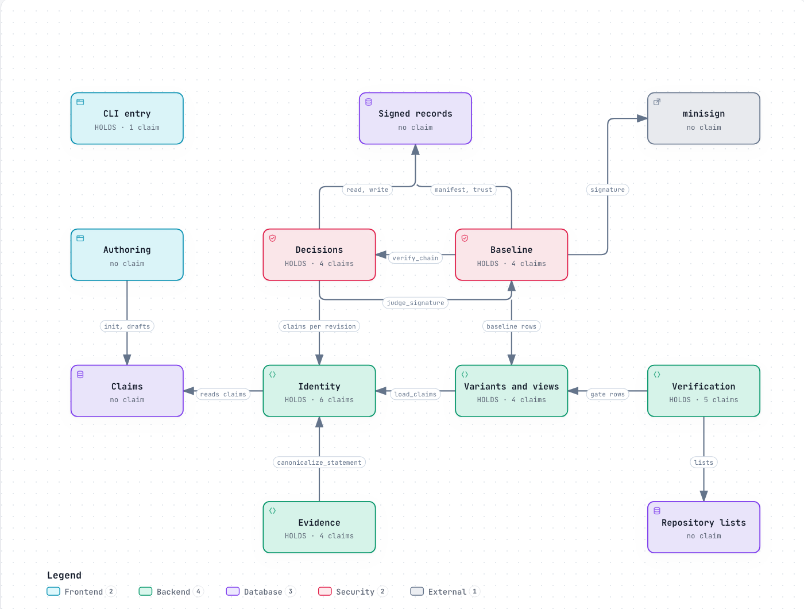
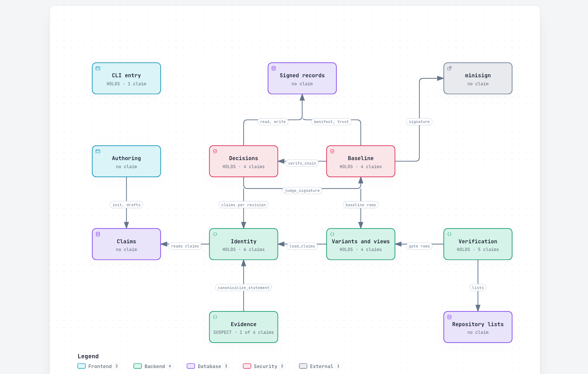

# req

A git-native requirements engine that tells you when a requirement's meaning changed, and in which direction.

**Requirements are decisions, not documents.** In req the unit of work is a *claim*: one
claim per file in git, written in a small, reviewable format. A claim's identity is its
`claim_id` — not its path and not its history, and not its wording. Its *meaning fingerprint* is
a content address over its *canonical meaning*: a deterministic pipeline parses the statement,
normalises it against a subject registry, and hashes the result — every time the claim is loaded,
so a claim file stores what its author wrote and nothing derived (`req.claim/2`, ADR 0022). A rewording
that the canonicalizer's rules cover keeps its address; an edit to a bound, an actor, or a modality gets a
new one, however similar the prose. What the fingerprint is *for* is drift and direction: between two
revisions, which requirements changed in meaning, and whether each change loosened or tightened the
obligation. It does not collapse independent paraphrase (see the probe under Status), so it is not a
duplicate finder. Two claims that do share an address are candidates for one requirement; req never merges
them, and a human ratifies.

The spec, the traceability matrix, and the audit packet are compiled views over a signed
baseline. Nobody edits them by hand; they are regenerated, and their freshness is verified
against what was signed.

## Requirements on the architecture

[](https://autox-my.github.io/req/architecture.html)

[The architecture page](https://autox-my.github.io/req/architecture.html) draws twelve parts of req and labels each with the worst
state of the requirements its code was recorded against (`req satisfy`, ADR 0040), and how many claims are in it. It is drawn by
hand from the source, and the status on every part is computed, never typed. 28 of req's 40 claims are linked to a part, and
all 28 claim–part pairs hold (29 on the detailed page, which splits the gate from its test-report reader); the [claims × parts matrix](docs/architecture/overview-matrix.md) lists them and the 12 claims no
part reaches. [Every part, with every arrow](https://autox-my.github.io/req/architecture-detail.html), is the detailed page
(its [matrix](docs/architecture/matrix.md)). How they are made and what the gate checks of them:
[ADR 0052](docs/adr/0052-an-architecture-diagram-shows-the-claims-its-components-satisfy.md).

### What drift looks like

[](https://autox-my.github.io/req/architecture-drift.html)

A presence check, or a tool that raises an alarm on any edit, cannot tell a re-wording from a change of meaning. req judges a link by the
*direction* of the claim's change since a human recorded it. [The drift page](https://autox-my.github.io/req/architecture-drift.html) is the
overview after one edit to REQ-0010 (the false-split bound, linked from `src/bench.rs`, drawn in the Evidence box): **made on a throw-away
copy of the corpus**, never on req's own claims, by `python3 tools/graph/build_architecture.py --drift docs/architecture/drift` from
[`edits.json`](docs/architecture/drift/edits.json), and checked by the gate. Three edits, side by side, with req's words for each:

| edit, on a copy | `req satisfy` says | the Evidence box | exact output |
| --- | --- | --- | --- |
| **cosmetic**: `at most 0.30` re-worded `no more than 0.30` | `HOLDS`: same meaning fingerprint (`req compare`: identical), so no false alarm | `HOLDS · 4 claims` | [satisfy.txt](docs/architecture/drift/cosmetic/satisfy.txt) |
| **loosening**: `at most 0.30` becomes `at most 0.40` | `HOLDS (weakened)`, `numeric_loosening`: what met the stronger requirement meets the weaker one | `HOLDS (weakened) · 1 of 4 claims` | [satisfy.txt](docs/architecture/drift/loosening/satisfy.txt) |
| **tightening**: `at most 0.30` becomes `at most 0.20` | `SUSPECT`, `numeric_tightening`, with the `req satisfy --record` command a human runs once the design is re-checked | `SUSPECT · 1 of 4 claims` | [satisfy.txt](docs/architecture/drift/tightening/satisfy.txt) |

Each directory under [`docs/architecture/drift/`](docs/architecture/drift/) also holds that edit's `overlay.json` and `matrix.md`; the matrix reads
the edited statement. The page is rendered from the tightening overlay; the real state, every link holding, is
[the architecture page](https://autox-my.github.io/req/architecture.html).

## The bet, stated so it can fail

> Deterministic canonicalization yields **zero false merges** on the corpora that measured it:
> the seed parity corpus with its adversarial traps, and the external families
> (`external-v1` to `external-v4`, other projects' real requirements prose, pinned by commit).
> At rules v9 no not-equivalent pair in those corpora shares an address.

A false merge silently deletes a requirement. A false split is noise. That asymmetry shapes
everything: the gate is zero false merges, it runs on every commit, and it has never been
relaxed to let a change land.

The bet is bounded to what was measured, and the bound matters. The *equivalent* pairs of the
external corpora are generated by the transforms Tier-1 itself implements, so a 0% false-split
rate there is expected and is not evidence that independent paraphrase does not collapse
differently; their *not-equivalent* pairs are a handful of mutation classes. Measuring
independent, human-written paraphrase is still open, and until it is done the bet is neither
validated nor refuted. The address that carries it is a *meaning fingerprint*, not the claim's
identity ([ADR 0020](docs/adr/0020-the-address-is-a-meaning-fingerprint.md), accepted).

## What it does

| command | the question it answers |
| --- | --- |
| `req init` | start a corpus here — a starter claim whose pins hold, its registry, and the authoring README |
| `req canon` | what each claim's statement derives, and whether each of its pins holds |
| `req bench` | does the fingerprint hold — zero false merges over the corpora; exit non-zero and the build is red |
| `req selftest` | does this installed binary, on this machine, derive what the project's reference build derives — known answers compiled in; reads no corpus |
| `req diff` | what changed in meaning between two revisions — each claim's class and flags, and an opt-in exit 1 for a pull request |
| `req pin` | is a corpus kept in another repository exactly the commit this repository pinned, and how has it moved since |
| `req select` | which claims apply in a variant — selectors, not branches — with UNKNOWN as a first-class answer |
| `req render`, `req trace` | the compiled spec view, and the traceability matrix with every edge named |
| `req impact`, `req gate` | what a change touches, nearest first, and the release policies |
| `req baseline`, `req audit` | the canonical manifest a human signs, drift verification, and the audit packet |
| `req decision` | the decision log and its hash chain — TAMPERED is a finding, a truncated history is unanswerable |
| `req propose <a> <b>` | one pair put to an external provider: its answer is an unratified proposal, never an edit — UNVERIFIABLE with no provider |

Tri-state is a discipline here, not a garnish: PASS, FAIL and UNVERIFIABLE are kept apart,
because "we could not tell" is a different answer from both "it passed" and "it is broken".

The **corpus root** is resolved at *runtime* (ADR 0012), so req manages any repository's
claims; how it is chosen, and every command's exit contract, are on `req --help` and
`req <command> --help` — the one home of those rules, readable with no corpus. `req init` is
the one command that resolves no root: it *creates* one.

## The two differentiators

1. **Drift and direction.** A content address over canonical *meaning*: an edit that changes an
   obligation gets a new address (the claim keeps its `claim_id`), with the direction of the change
   classified, so a weakening is never reported as no change. `req diff` puts that on a pull request:
   between two revisions, each claim added, removed, weakened, tightened or reshaped, as a description
   for a human to read, never a verdict.
2. **Variability as selectors.** A variant is a query over one model of claims, not a branch
   or a fork: variants compose, applicability is computed per context, and a claim a context
   cannot decide is surfaced rather than dropped.

Git-native storage is table stakes, not the moat.

## Status

- **Tier-1 is built and measured.** `RULES_V 8`, 39 dogfood claims — req's own requirements,
  written in req's own format — and seven corpus families, including three of real
  requirements prose from other projects, pinned by commit. Zero false merges on all of them.
- **Tier-2 is measured and deliberately conservative.** Five providers evaluated against a
  human-labelled sample; one has a usable confidence ordering at a measured floor; the honest
  default is `NoProvider` until a provider survives held-out validation on a grown,
  blind-labelled corpus. The funnel and its instruments are research, kept out of the core in
  `experiments/tier2/` ([ADR 0021](docs/adr/0021-tier-2-leaves-the-core.md)); the protocol is
  `experiments/tier2/docs/tier2-sample-protocol.md`. The core keeps only the single-pair
  `req propose` seam.
- **Paraphrase probe (run once, 2026-11-03).** `experiments/paraphrase/` measures how often
  independently worded text for one obligation fails to share a Tier-1 address. Across three model
  families, none of 272 judge-confirmed restatements of 60 real statements shares an address with
  its original (0 of 180 one-element alterations collapse). Model-authored, blind to Tier-1,
  judge-filtered, not human: a lower bound on how far real writers diverge, and it neither validates
  nor refutes the bet. Tier-1 is a drift and direction fingerprint, not a paraphrase collapser;
  that is Tier-2's job. Read its README first.

## Install

req is not on crates.io (`publish = false`): you pin a commit, and the commit is the provenance. **Two
prebuilt releases exist: `rev-ec87808` (Linux x86_64) and `rev-6b74f51` (Linux x86_64 and macOS arm64, Apple
silicon only)**. There is no Intel Mac build and no native Windows build (on Windows, run the Linux tarball under
WSL2: `docs/adopting.md`, *Windows*). For any other rev, or any other machine, the install is a build from source
at a rev you choose:

```bash
cargo install --git https://github.com/autox-my/req.git --rev <REV> --locked req
```

`docs/adopting.md` (*Install req*) explains the pin, the prebuilt-binary path,
and the air-gapped route. req is early (`0.1.0`), maintained by one person, and its claims are bounded as
stated under *Status*.

## Development

```bash
cargo install cargo-nextest --version 0.9.149 --locked   # the JUnit report the release gate reads
cargo build --release
cargo run -q -- bench     # the gate: zero false merges, or the build is red
./scripts/check.sh        # fmt, clippy, nextest + its report, canon + Baseline verification, every corpus
```

The test run is `cargo nextest run --profile ci`; it replaces `cargo test` (one run, one truth) and
its report is what `req gate --test-report` reads. The gate's detail is in `AGENTS.md`.

Changes go through a feature branch and a pull request (see `CONTRIBUTING.md`). CI runs the same gate that
runs locally; there is no automated review, a human reads every pull request. The
agent-facing instructions are in `AGENTS.md`, the glossary in `CONTEXT.md`, the design of
record in `docs/design.md`, and the decisions in `docs/adr/`.

How it works: `docs/how-it-works.md` (diagrams, for engineers) and `docs/overview.html` ([read it rendered](https://autox-my.github.io/req/overview.html); one page for
non-developers, generated from the real tool by `tools/overview/build.py`, never hand-edited).

Existing requirements need not be retyped: `tools/adopt.py` (markdown lists), `tools/needs_import.py`
(a Sphinx-Needs `needs.json`) and `tools/reqif_import.py` (a ReqIF file, as DOORS, Polarion and Eclipse ProR
export) draft claims from them, copy-and-adjust scripts whose drafts are proposals for a human to ratify
(`docs/adopting.md`). The ReqIF reader has been run on three small public sample files only; its yield on a real
specification is unmeasured.

Adopting req in a project — as a human or as an agent — starts at `docs/adopting.md` (its
"For an agent" section is the five-minute path): the CI snippet is `examples/github-workflows/req.yml`,
and `examples/agents-snippet.md` is a block to paste into a project's own `AGENTS.md`.
`tools/quickstart.sh` rehearses the path offline and prints `QUICKSTART <n>s`; the page is
rehearsed by the script, not asserted by it.

## Licence

Apache-2.0; see [`LICENSE`](LICENSE). Test and benchmark data taken from other projects keeps its own
licence and is listed in [`NOTICE`](NOTICE).
