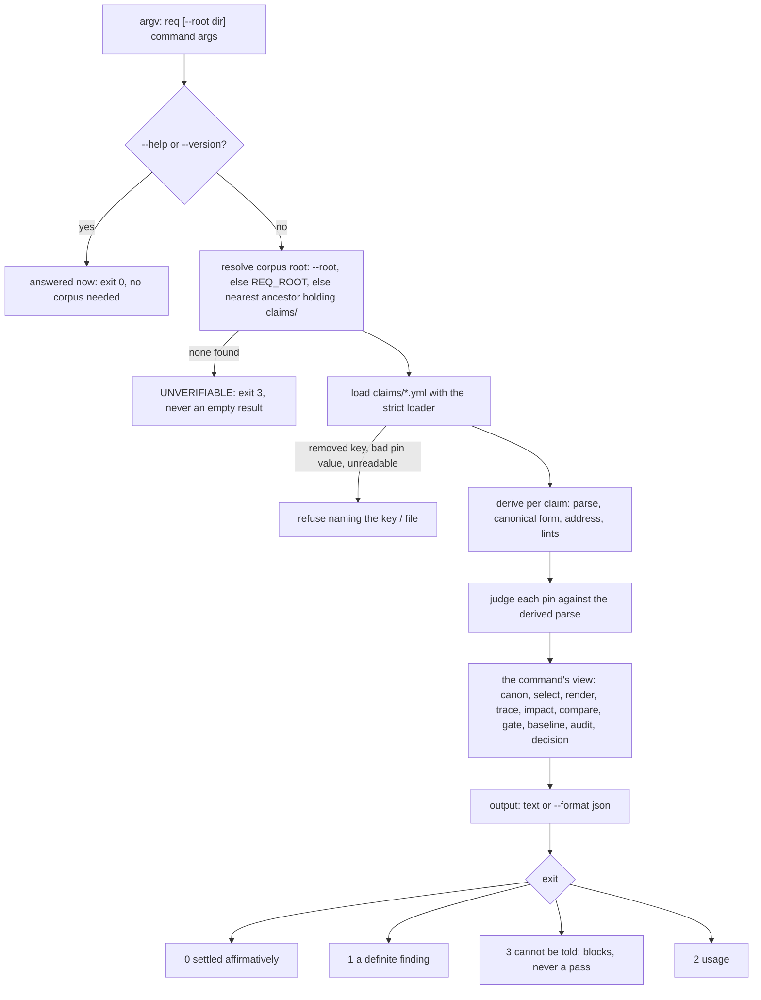
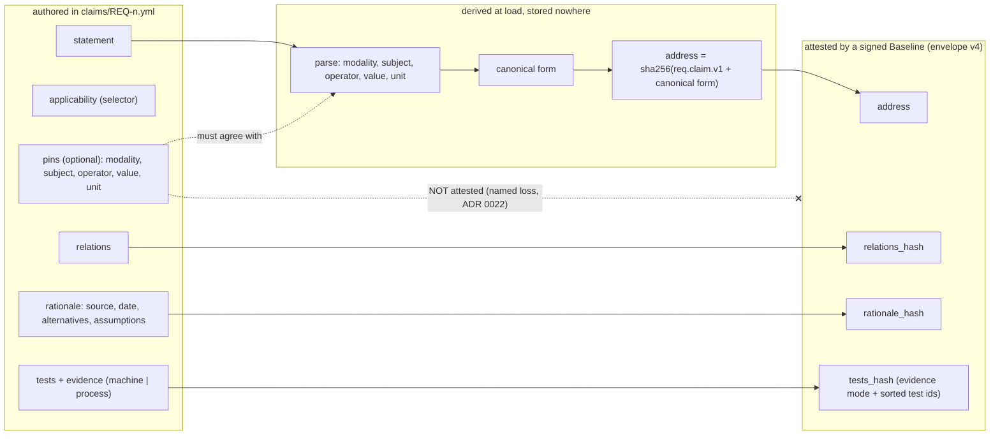
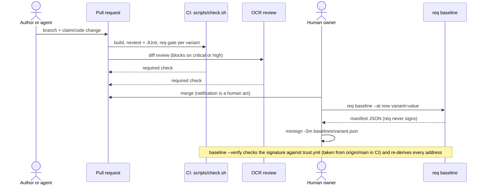

# How req works — the engineering view

The page for people who will read, extend or debug req. Three diagrams (Mermaid; they render on the
forge and in most editors) and the one honest statement about extension. The commands' contracts are
`req --help` and `req <command> --help`; the adopter's loop is `docs/adopting.md`; the decisions are in
`docs/adr/`. This page restates none of them, it draws how they connect. For managers and
non-developers there is a separate generated page, `docs/overview.html`.

## 1. What one command does

Every command is the same pipeline with a different view at the end. Help and version are answered
**before** any corpus is resolved, so they work anywhere.

The views at the end of the pipeline are `req canon`, `req select`, `req render`, `req trace`,
`req impact`, `req compare`, `req gate`, `req baseline`, `req audit` and `req decision`; the one process
boundary is `req propose`.

The exit contract is tri-state everywhere (PASS / FAIL / UNVERIFIABLE) plus usage. `canon` is diagnostics
and exits 0 on a flagged pin; the check that gates a pin is `gate` (`pins_hold`).

## 2. What is authored, what is derived, what is signed

Nothing derived is stored in a claim file (`req.claim/2`, ADR 0022): the loader computes it every time.

The address is a **meaning fingerprint**: two wordings with the same canonical meaning share it, and a
change that moves meaning moves it. A false merge (two different requirements, one address) is the one
failure the design is built to never make; a false split is only review noise.

## 3. How a change reaches a release, and who signs what

A claim edited after signing is FAIL at verify; a manifest built under another `RULES_V` is
UNVERIFIABLE, not judged.

## Extension points

There is **no in-process plugin API**, deliberately: the core has no network dependency and runs
air-gapped (REQ-0012). Extension is at process and file boundaries:

| you want to | the seam | what req guarantees |
| --- | --- | --- |
| bring prose in | copy and adjust `tools/adopt.py` (it is a starting point, not an interface) | drafts are proposals; every skipped line is named |
| prove a claim with tests | a JUnit report to `req gate --test-report` | an absent, unparsable or empty report is UNVERIFIABLE |
| ask a model about one pair | `req propose a.yml b.yml --provider-cmd <cmd>` | the answer is an unratified proposal; nothing is written, no address moves |
| consume results in tooling | `--format json` on `render`, `trace`, `gate`, `audit` | same verdict and exit code as the text form |
| hand a step to an agent | `examples/handoff-brief.md` and `examples/agents-snippet.md` | the agent prechecks `req --version` and reports exit codes |

## Where to read next

`docs/design.md` (the tensions and layers), `docs/claim-format.md` (the file contract),
`docs/canonical-hashing.md` (the Tier-1 rules and the benchmark protocol), `docs/adr/0022-*.md` (authored
claims, derived fingerprints).
